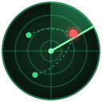
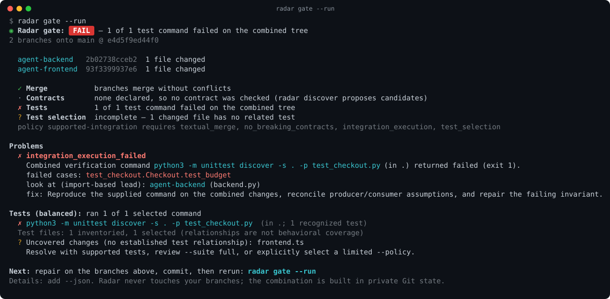

<p align="center"></p>

# Radar

**Two agents. Two green branches. One broken merge. Radar catches it before you merge.**

You run coding agents in parallel, each in its own worktree (cmux, Orca, Claude
Code, Codex, or plain `git worktree`). Each branch passes its own tests. Merged
together, they break. Radar combines the branches in private Git state, checks
the combination, runs selected tests when authorized, and provides repair leads.

It is a local CLI. It needs no API key, sends no telemetry, and never touches
your branches.

## Try it in one minute

Two agents edit separate branches. Each branch passes its tests. Combined,
they fail. Paste this into a shell after [installing](#install) Radar (it
needs Git and Python 3 and works in a new temporary directory):

```sh
cd "$(mktemp -d)" && git init -q -b main shop && cd shop
git config user.name demo && git config user.email demo@example.com
printf 'def price():\n    return 1\n' > backend.py
printf 'export const QUANTITY = 1;\n' > frontend.ts
cat > test_checkout.py <<'PY'
import re, unittest
from pathlib import Path
from backend import price

class Checkout(unittest.TestCase):
    def test_budget(self):
        quantity = int(re.search(r"QUANTITY = (\d+)", Path("frontend.ts").read_text())[1])
        self.assertLessEqual(price() * quantity, 2)
PY
git add . && git commit -qm baseline
git worktree add -q -b agent-backend ../backend
git worktree add -q -b agent-frontend ../frontend
printf 'def price():\n    return 2\n' > ../backend/backend.py
git -C ../backend commit -qam 'Raise price'
printf 'export const QUANTITY = 2;\n' > ../frontend/frontend.ts
git -C ../frontend commit -qam 'Raise quantity'

radar gate          # PASS (static): the branches merge cleanly; no test ran
radar gate --run    # FAIL: the combined tree breaks the budget test
```

<p align="center"></p>

<details>
<summary>The same report as plain text</summary>

```console
$ radar gate --run
Radar gate: FAIL — 1 of 1 test command failed on the combined tree
2 branches onto main @ e4d5f9ed44f0

  agent-backend   2b02738cceb2  1 file changed
  agent-frontend  93f3399937e6  1 file changed

  ✓ Merge           branches merge without conflicts
  · Contracts       none declared, so no contract was checked (radar discover proposes candidates)
  ✗ Tests           1 of 1 test command failed on the combined tree
  ? Test selection  incomplete — 1 changed file has no related test
  policy supported-integration requires textual_merge, no_breaking_contracts, integration_execution, test_selection

Problems
  ✗ integration_execution_failed
    Combined verification command python3 -m unittest discover -s . -p test_checkout.py (in .) returned failed (exit 1).
    failed cases: test_checkout.Checkout.test_budget
    look at (import-based lead): agent-backend (backend.py)
    reproduce: d=$(mktemp -d) && git worktree add --detach "$d" e4d5f9ed44f0 && cd "$d" && git merge --no-ff --no-edit --no-verify 2b02738cceb2 && git merge --no-ff --no-edit --no-verify 93f3399937e6 && python3 -m unittest discover -s . -p test_checkout.py
    fix: Reproduce the supplied command on the combined changes, reconcile producer/consumer assumptions, and repair the failing invariant.

Tests (balanced): ran 1 of 1 selected command
  ✗ python3 -m unittest discover -s . -p test_checkout.py  (in .; 1 recognized test)
  Test files: 1 inventoried, 1 selected (relationships are not behavioral coverage)
  ? Uncovered changes (no established test relationship): frontend.ts
    Resolve with supported tests, review --suite full, or explicitly select a limited --policy.

Next: repair on the branches above, commit, then rerun: radar gate --run
Details: add --json. Radar never touches your branches; the combination is built in private Git state.
```

</details>

`look at` is an import-based repair lead, not proof of blame. Extra diagnostic
reruns are off by default. Use `radar gate --run --attribution-runs 8` to look
for a smaller branch combination that reproduces the failure; `observed` lines
describe those bounded reruns and remain repair leads. The
`reproduce` line rebuilds the same commits in a throwaway worktree under a
new temporary directory (remove it later with `git worktree remove`). It
skips commit hooks like Radar does, but checkout and merge hooks, your Git
configuration and your environment still apply, so it can differ from
Radar's sanitized run.

## Install

Linux (amd64, arm64) and macOS (Apple Silicon, Intel):

```sh
curl -fsSL https://raw.githubusercontent.com/Jake-Network/radar/v0.2.0/scripts/install-release.sh | bash -s -- --version v0.2.0
```

This installs a checksum-verified binary to `~/.local/bin` (`--dir` changes it).
Binaries need no Go or C compiler; Git is required, and `radar gate --run` uses
your repository's own test runners. Then:

```sh
radar doctor
```

Windows binaries are not published yet: Windows Git defaults such as
`core.autocrlf` are not handled yet. On other systems, build from source with Go 1.23+ and a native C compiler (for Tree-sitter):

```sh
go install github.com/Jake-Network/radar/cmd/radar@v0.2.0
```

Release details and runtime limits: [RELEASING](docs/RELEASING.md).

This page describes v0.2.0. Release changes are listed in the
[changelog](CHANGELOG.md).

## First run in your repository

```sh
radar doctor          # base, agent branches, uncommitted worktrees, test runners, next step
radar setup claude    # optional: connect Claude Code (or codex, both); add --dry-run first
radar gate            # combine every agent branch and check it; runs no code
radar gate --run      # also run the related tests on the combined tree
```

Radar needs no configuration. `radar gate` picks the base (`origin/HEAD`'s
branch, `main`, `master` or `trunk`) and every worktree branch with commits
beyond it. Name branches to choose them: `radar gate agent-a agent-b --base
develop`. Gate checks committed changes; uncommitted work in a worktree is
listed and left out, so commit first. `radar watch --include-dirty` can instead
preview saved staged, unstaged and nonignored untracked changes in private
snapshots; those results do not verify the committed branches.

In a terminal, bare `radar` opens a menu that shows the same information and
runs the same commands (tests only after you confirm). `radar watch` rechecks
while agents commit; see [WATCH](docs/WATCH.md).

## Reading the result

| Verdict | Exit | Meaning |
| --- | --- | --- |
| `PASS (static)` | 0 | Branches merge and declared contracts hold. No test ran |
| `PASS (selected policy; bounded verification)` | 0 | The selected tests also ran and passed on the combined tree. Not full coverage |
| `FAIL` | 1 | A conflict, a breaking declared contract, or a failing test on the combined tree |
| `NOT VERIFIED` | 1 | Required evidence is missing. Each gap has a `fix:` line |
| `ERROR` | 2 | A check errored or timed out. If Radar cannot start (bad ref, unsupported layout), it prints `radar: …` and `Next:` instead, also exit 2 |

Marks: `✓` passed, `✗` failed, `?` not verified, `!` needs attention, `·` not
checked or skipped. Color only decorates them; `NO_COLOR` and pipes give plain text.
`--json` output is never styled. Every report ends with one `Next:` step.

Common `NOT VERIFIED` causes and fixes:

- **A test runner could not start.** Radar copies only committed files, so
  `node_modules` and virtualenvs are missing from its private copy, and it
  never installs dependencies. Install the runner, or run those tests yourself.
- **The command budget ran out.** Raise it with `--max-commands N`.
- **Only documentation changed.** No test applies to documentation by static
  relationships, and Radar cannot show that no test reads it, so `--run` has
  no evidence. The static `radar gate` result is what Radar verifies here.
- **A changed file has no related test.** Static imports found none. Add a
  test, try `--suite full`, or choose a limited `--policy` deliberately.
- **Test discovery skipped a file** (oversized, symlink, unreadable), so the
  inventory is incomplete.

Radar refuses symlinks and submodules in the combined tree, and a shallow clone
needs `git fetch --unshallow`. Both errors say so.

## Agents

`radar setup claude` (or `codex`, or `both`) installs a project skill and the
MCP server. Agents then call `radar_gate` (or `radar gate --json`) before they
propose a merge, read `gate.verdict` and `next`, repair, commit and recheck.
Agents never run `--run` on their own: it executes repository code, so a
person authorizes it. `radar help agents` prints the agent contract, and
[AGENT_GUIDE](docs/AGENT_GUIDE.md) walks through the whole workflow.

## What a PASS means

Radar reports evidence. It doesn't certify correctness.

- **PASS** means every named requirement passed within the reported scope. It
  is not comprehensive verification. `PASS (static)` means no test ran.
- **Import-based analysis** follows imports. It does not resolve compiler
  types or see runtime reads such as files, environment variables or network
  calls.
- **Attribution** (`observed`, `look at`) is a lead for repair. Each rerun
  happens once, so a flaky test can mislead it.
- **Not a sandbox:** `--run` executes your tests with your permissions in a
  private copy of the combined source. That copy is not an operating-system
  sandbox.

Full guarantees and limits: [CAPABILITIES](docs/CAPABILITIES.md),
[VERIFICATION_POLICY](docs/VERIFICATION_POLICY.md), [SECURITY](docs/SECURITY.md).

## More

- **Several repositories:** `radar workspace add ../payments`, then `radar
  gate` checks every workspace repository, and declared cross-repository
  links. See [MULTI_REPO](docs/MULTI_REPO.md).
- **CI:** `radar gate --run --policy .radar/integration-policy.json feature/api
  feature/web` with an explicit list of required checks, or the
  [GitHub Actions integration](integrations/github-actions/README.md). See
  [VERIFICATION_POLICY](docs/VERIFICATION_POLICY.md#policies).
- **What it checks:** merge in private Git state; OpenAPI and JSON Schema
  contracts declared in `.radar/contracts.json` (discovered candidates are
  warnings); import graphs for TypeScript/JavaScript, Python, Go, Rust, Java
  and C/C++; test selection and execution within a time and command budget.
  See [CAPABILITIES](docs/CAPABILITIES.md) and [TEST_SELECTION](docs/TEST_SELECTION.md).
- **Plans and evidence:** grounded plans, digest-bound reviews, commit-bound
  test evidence and graph queries, under `radar help --all`. See
  [USAGE](docs/USAGE.md).
- **Demos:** [DEMO](docs/DEMO.md), including `examples/quickstart/demo.sh` for
  the scenario above.

## Development

```sh
go test ./...
go vet ./...
bash scripts/smoke.sh "$(go build -o /tmp/radar ./cmd/radar && echo /tmp/radar)"
make demo-all
```

Native release jobs target Linux and macOS (amd64 and arm64).
Tags prepare assets; publishing requires a separate manual request. See
[RELEASING](docs/RELEASING.md) and the [changelog](CHANGELOG.md).
Also see [contributing](CONTRIBUTING.md), [architecture](docs/ARCHITECTURE.md),
[benchmarks](docs/BENCHMARKS.md) and the [roadmap](docs/ROADMAP.md). MIT licensed.
